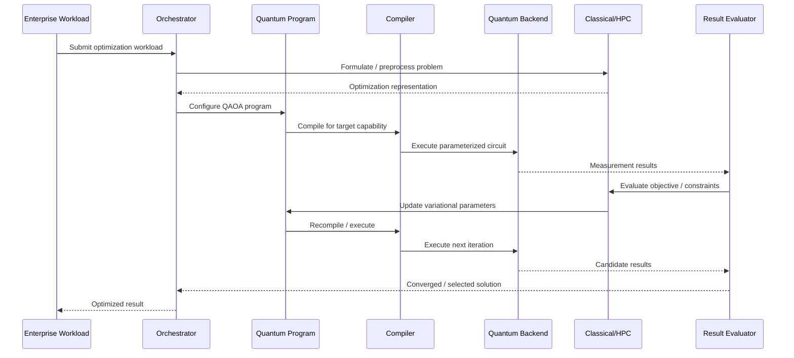

# Enterprise Quantum Optimization Reference Architecture

 **Version:** 1.0\
 **Status:** Reference Architecture\
 **Audience:** Principal Architects, Principal Engineers, Technology Leadership\
 **Scope:** Enterprise constrained combinatorial optimization\
 **Primary quantum workload:** Quantum Approximate Optimization Algorithm (QAOA)\
 **Architectural stance:** Vendor-neutral, backend-agnostic, hybrid classical–quantum

---

 ## 1\. Executive Summary

 Quantum computing is unlikely to enter the enterprise as a replacement for classical computing. Its more credible near- and medium-term role is as a specialized computational capability invoked from broader classical workflows for problem classes with potentially favorable quantum formulations.

 This reference architecture defines a vendor-neutral architectural pattern for incorporating quantum computation into enterprise optimization workflows. It is designed around constrained combinatorial optimization problems with discrete decision variables and competing objectives, including scheduling, resource allocation, routing, and assignment.

 The architecture treats quantum processing as a specialized execution capability within a predominantly classical computational system. Classical systems remain responsible for enterprise data, problem formulation, constraint handling, orchestration, solution evaluation, and downstream business integration. Quantum processors are invoked selectively for computational stages for which a quantum formulation is appropriate.

 QAOA is the primary quantum workload considered by the architecture. Variational quantum programs are represented through an abstraction layer that separates optimization logic and algorithmic intent from compilation and backend execution. This separation is intended to prevent the enterprise architecture from becoming dependent on a particular quantum hardware technology, software stack, or provider.

 The architecture prioritizes the following quality attributes:

1. **Portability**
2. **Interoperability**
3. **Scalability**
4. **Resource efficiency**
5. **Evolvability**
6. **Noise tolerance**
7. **Reliability**
8. **Latency**

 The resulting architecture provides a path for enterprises to become quantum-enabled without making an immediate commitment to a particular quantum technology. This is especially relevant while current quantum systems remain constrained by noise, error correction, available resources, and workload size.

 The architectural proposition is therefore not that enterprises should assume quantum advantage exists today. Rather, it is that enterprises can establish the architectural capabilities required to consume quantum computation while preserving the ability to adopt improved algorithms and hardware as the technology matures.

---

 # 2\. Context & Problem

 ## 2.1 Enterprise optimization context

 Enterprises routinely encounter optimization problems in which a large number of discrete decisions must be made subject to interacting constraints.

 Representative workload classes include:

 - **Scheduling** — assigning activities, jobs, or operations to time and resource slots.
- **Resource allocation** — distributing limited resources across competing demands.
- **Routing** — determining efficient paths through a network subject to operational constraints.
- **Assignment** — mapping entities, tasks, or activities to available resources or locations.

 Although these problems differ at the business level, they share an architectural pattern:

 > **Enterprise data → constrained optimization model → computational optimization → candidate solutions → evaluation → enterprise decision**

 Many such problems can be represented using binary or discrete optimization formulations. QAOA is specifically designed as a hybrid quantum-classical approach for combinatorial optimization, in which a quantum circuit generates candidate states while a classical optimization loop updates circuit parameters.  IBM Quantum

 The architecture therefore focuses on the computational boundary where an enterprise optimization problem becomes a candidate workload for hybrid quantum-classical processing.

 ## 2.2 Architectural problem

 A naïve approach would embed a particular quantum SDK, algorithm implementation, and quantum backend directly into an enterprise application.

 That approach creates several architectural problems:

 - Dependence on a particular quantum provider.
- Coupling between business logic and quantum implementation details.
- Difficulty substituting quantum hardware as the ecosystem evolves.
- Limited ability to compare alternative execution strategies.
- Exposure of hardware-specific constraints to enterprise applications.
- Difficulty determining whether a workload should execute classically or quantumly.
- Increased risk that an architectural investment becomes obsolete as quantum technology changes.

 A quantum-enabled enterprise architecture therefore requires an intermediate abstraction between **enterprise optimization intent** and **quantum execution**.

 ## 2.3 Architectural hypothesis

 The central architectural hypothesis is:

 > **Quantum computation should be exposed to enterprise workloads as an interchangeable specialized compute capability rather than as a technology-specific application dependency.**

 This implies that the architecture must preserve a clear separation between:

 - Enterprise optimization intent
- Mathematical problem representation
- Quantum algorithm
- Quantum program
- Compilation and hardware mapping
- Backend execution
- Result interpretation

 This separation is the foundation of the reference architecture.

 ## 2.4 Current technology context

 Current quantum systems remain constrained by noise and limited error correction. SAP's current architecture guidance explicitly describes QPUs as specialized mathematical coprocessors invoked for complex optimization or simulation tasks, accessed through standardized APIs that abstract vendor differences, with classical outputs returning to deterministic enterprise workflows.  architecture.learning.sap.com

 SAP has also previously demonstrated integration of quantum services into an enterprise vehicle-space optimization component, mapping a business problem into a quadratic formulation, invoking QAOA, and post-processing probabilistic results within the optimization engine.  SAP News Center

 These examples are not architectural dependencies of this reference architecture. They are evidence that the architectural pattern addressed here is relevant to emerging enterprise quantum computing models.

---

 # 3\. Architecture Scope & Boundaries

 ## 3.1 Scope

 The reference architecture begins when an enterprise optimization workload has been identified and represented as a computational optimization problem.

 It covers:

1. Problem formulation and encoding.
2. Optimization orchestration.
3. Quantum algorithm selection.
4. Variational program representation.
5. Backend abstraction.
6. Compilation and hardware mapping.
7. Classical/HPC execution.
8. Quantum execution.
9. Result collection and evaluation.
10. Return of the optimized result to the consuming enterprise workflow.

 ## 3.2 Boundary

```
flowchart LR

    E[Enterprise Optimization Workload]
    F[Problem Formulation & Encoding]

    subgraph RA[Quantum Optimization Reference Architecture]
        O[Optimization Orchestrator]
        P[Quantum Program / Algorithm Layer]
        A[Backend Abstraction]
        C[Compilation & Hardware Mapping]

        subgraph HY[Hybrid Execution]
            CL[Classical / HPC Compute]
            Q[Quantum Compute]
        end

        R[Result Processing & Evaluation]
    end

    X[Enterprise Consumer]

    E --> F
    F --> O
    O --> P
    P --> A
    A --> C
    C --> CL
    C --> Q
    CL --> R
    Q --> R
    R --> X
```

 ## 3.3 Inside the boundary

 The architecture owns the computational pathway between the enterprise optimization problem and its optimized computational result.

 In particular, it defines how:

 - An optimization problem is transformed into a suitable computational representation.
- A quantum algorithm is selected and configured.
- Quantum programs are represented independently of a particular backend.
- Classical and quantum resources participate in a single workflow.
- Hardware constraints influence execution.
- Quantum results are evaluated and incorporated into the overall optimization process.

 ## 3.4 Outside the boundary

 The following are explicitly outside Version 1:

 - Quantum processor fabrication.
- Qubit physics and device engineering.
- Detailed quantum SDK implementation.
- Provider-specific APIs.
- Production application implementation.
- Enterprise transactional-system architecture.
- Detailed cloud-provider deployment architecture.
- Physical data-center architecture.
- Actual QPU experimentation.
- Claims of demonstrated quantum advantage.

 The architecture is concerned with **how an enterprise could consume quantum computation**, not with designing the quantum computer itself.

---

 # 4\. Architectural Requirements & Quality Attributes

 ## 4.1 Functional requirements

 The architecture shall:

 - Support constrained combinatorial optimization workloads.
- Represent optimization problems independently from quantum hardware.
- Support QAOA as the primary quantum algorithm.
- Support variational quantum programs where required by the architecture.
- Coordinate classical and quantum execution.
- Allow quantum backends to be substituted without changing enterprise optimization intent.
- Incorporate hardware characteristics into execution decisions.
- Return quantum-derived results into classical evaluation and enterprise workflows.

 ## 4.2 Quality-attribute priorities

 | Rank | Attribute | Priority | Architectural interpretation |
| --- | --- | --- | --- |
| 1 | **Portability** | Critical | Avoid dependence on a specific backend or quantum technology. |
| 2 | **Interoperability** | Critical | Integrate quantum execution with classical, HPC, cloud, and enterprise systems. |
| 3 | **Scalability** | Very High | Support growth in workload size and computational resources. |
| 4 | **Resource Efficiency** | Very High | Minimize unnecessary quantum, classical, communication, and execution resources. |
| 5 | **Evolvability** | Very High | Accommodate changing algorithms, compilation techniques, and hardware capabilities. |
| 6 | **Noise Tolerance** | High | Account for noisy quantum execution and imperfect hardware. |
| 7 | **Reliability** | High | Provide predictable, observable, and governable computational behavior. |
| 8 | **Latency** | Medium | Control execution latency without allowing it to dominate more important architectural concerns. |

 ## 4.3 Architectural tensions

 The quality attributes are not independent.

 For example:

 - Greater portability can introduce abstraction overhead.
- Hardware optimization can conflict with backend neutrality.
- Noise mitigation can consume additional resources.
- Increased circuit depth may improve algorithmic expressiveness while reducing execution reliability.
- Greater orchestration sophistication can increase control-plane complexity.
- Lower latency may require stronger coupling to a particular execution environment.

 The architecture therefore treats these attributes as **optimization dimensions rather than absolute requirements**.

---

 # 5\. Target Reference Architecture

 ## 5.1 Architectural overview

 The reference architecture consists of six principal logical layers:

 1. **Enterprise Workload Layer**
2. **Optimization Formulation Layer**
3. **Optimization Orchestration Layer**
4. **Quantum Program & Abstraction Layer**
5. **Hybrid Execution Layer**
6. **Result & Enterprise Integration Layer**

```
flowchart TB

    subgraph L1[1. Enterprise Workload Layer]
        W[Scheduling]
        A1[Resource Allocation]
        RT[Routing]
        AS[Assignment]
    end

    subgraph L2[2. Optimization Formulation Layer]
        M[Mathematical Model]
        C1[Constraints]
        O1[Objective Function]
        E1[Encoding / QUBO Representation]
    end

    subgraph L3[3. Optimization Orchestration Layer]
        S[Workload Suitability]
        D[Execution Strategy]
        G[Resource Governance]
    end

    subgraph L4[4. Quantum Program & Abstraction Layer]
        V[Variational Program]
        QAOA[QAOA]
        AB[Backend Abstraction]
        TR[Compilation / Transformation]
    end

    subgraph L5[5. Hybrid Execution Layer]
        CPU[Classical / HPC]
        QPU[Quantum Processor]
    end

    subgraph L6[6. Result & Integration Layer]
        RP[Result Processing]
        EV[Solution Evaluation]
        OUT[Optimized Result]
    end

    W --> M
    A1 --> M
    RT --> M
    AS --> M

    M --> C1
    M --> O1
    C1 --> E1
    O1 --> E1

    E1 --> S
    S --> D
    D --> G

    D --> V
    V --> QAOA
    QAOA --> AB
    AB --> TR

    G --> CPU
    G --> QPU
    TR --> CPU
    TR --> QPU

    CPU --> RP
    QPU --> RP
    RP --> EV
    EV --> OUT
```

 ## 5.2 Enterprise Workload Layer

 This layer represents the optimization intent originating from an enterprise process.

 The architecture does not prescribe a particular industry or enterprise application. Instead, it defines a workload class characterized by:

 - Discrete decisions.
- Explicit constraints.
- One or more optimization objectives.
- Potentially large search spaces.
- A requirement to compare candidate solutions.

 The four representative workload classes are deliberately diverse enough to exercise the architecture without making the architecture specific to any one application.

 ## 5.3 Optimization Formulation Layer

 This layer transforms enterprise optimization intent into a mathematical representation suitable for computational optimization.

 The formulation contains:

 - Decision variables.
- Constraints.
- Objective functions.
- Feasibility conditions.
- Penalty or constraint-handling mechanisms where required.
- An encoded representation suitable for downstream optimization.

 For QAOA-oriented workflows, quadratic binary formulations provide a useful architectural interface because they can be transformed into cost Hamiltonians suitable for quantum execution. IBM's current QAOA documentation describes the transformation from combinatorial optimization problems through QUBO representations into cost Hamiltonians and parameterized circuits.  IBM Quantum

 The architecture deliberately places this formulation **before** the quantum algorithm layer.

 This prevents the quantum algorithm from becoming the representation of the business problem.

 ## 5.4 Optimization Orchestration Layer

 The orchestration layer determines how an optimization workload should be executed.

 Its responsibilities include:

 - Selecting an execution strategy.
- Determining whether quantum execution is appropriate.
- Coordinating classical and quantum computation.
- Managing iterative optimization loops.
- Applying resource constraints.
- Managing execution state.
- Collecting candidate solutions.
- Initiating solution evaluation.

 This layer is critical because QAOA is inherently hybrid: the quantum processor evaluates parameterized circuits while a classical optimizer updates the variational parameters.  IBM Quantum

 The architecture therefore does not model the QPU as a standalone solver. It models it as one participant in an **iterative computational workflow**.

 ## 5.5 Quantum Program & Abstraction Layer

 This layer provides the principal separation between optimization intent and quantum implementation.

 The logical decomposition is:

```text
Optimization Problem
        ↓
Quantum Algorithm
        ├── QAOA — primary
        ├── VQE — representative extension
        └── Other VQAs
        ↓
Variational Program
        ↓
Backend-Abstraction Interface
        ↓
Compilation / Transformation
        ↓
Execution Backend
```

 The Variational Program represents abstract quantum-program intent independently of any particular implementation framework. This abstract program may be instantiated through implementation frameworks such as Qiskit, PennyLane, or CUDA-Q, while the reference architecture remains framework-independent.

 Implementation frameworks therefore serve as realizations of the Variational Program abstraction rather than as additional architectural layers. The resulting conceptual relationship is:

```text
Variational Program
        ↓
Implementation Framework
    ├── Qiskit
    ├── PennyLane
    └── CUDA-Q
        ↓
Backend-Abstraction Interface
```

 This is a conceptual implementation relationship, not a new architectural layer or dependency. The same architectural boundary can accommodate alternative frameworks without changing the underlying reference architecture.

 For QAOA, the Variational Program includes concepts such as:

 * Cost representation.
 * Mixer representation.
 * Circuit depth.
 * Variational parameters.
 * Initial state.
 * Measurement requirements.
 * Classical parameter optimization.

 The backend abstraction exposes the capabilities required for execution while hiding backend-specific mechanisms.

 No new VQA architectural layer is introduced. **VQA is represented as the general algorithmic abstraction through which QAOA, VQE, and other variational algorithms fit into the existing Quantum Program & Abstraction Layer.**

## 5.6 Compilation and hardware mapping

 The compilation boundary translates the abstract quantum program into a representation executable by a target quantum backend.

 The architecture recognizes that physical connectivity and available operations can materially affect the resulting circuit.

 Therefore, compilation is not treated as a transparent technical afterthought. It is an architectural stage at which:

 - Logical interactions are mapped to physical connectivity.
 - Additional operations may be introduced.
 - Circuit depth can change.
 - Resource requirements can change.
 - Hardware-dependent execution characteristics can influence backend suitability.

 A concrete implementation of this compilation and transformation responsibility could use a compiler such as TKET. TKET can perform circuit transformations and hardware-oriented compilation, including mapping logical operations to the connectivity and operation constraints of a target backend.

 TKET is therefore treated as an illustrative implementation of the compilation boundary rather than as an architectural dependency. The reference architecture defines the responsibility for compilation and hardware mapping, while the specific compiler or transformation technology can be substituted as the implementation ecosystem evolves.

 This preserves the architectural distinction between the compilation responsibility and the technology used to implement it: the architecture requires that logical quantum programs be transformed for the selected execution backend, but does not require TKET specifically.

 Current QAOA execution guidance illustrates this issue explicitly: hardware connectivity can require routing strategies and additional circuit operations during transpilation.  IBM Quantum

 The architecture nevertheless keeps compilation behind the abstraction boundary so that hardware-specific decisions do not leak into enterprise optimization logic.

 The compiled quantum program may subsequently target either a simulator or a physical quantum backend. For example, Aer can provide a simulator execution path for a Qiskit-based implementation, allowing the same logical workload to be evaluated without requiring physical QPU execution.

 This reinforces the architectural distinction between the quantum program and the execution target: compilation produces a backend-oriented representation, while the subsequent execution environment may be a simulator or a physical QPU.

---

 # 6\. Key Architectural Components

 ## 6.1 Problem Model

 The Problem Model provides a canonical representation of the optimization workload.

 It contains:

 - Decision variables.
- Variable domains.
- Constraints.
- Objective functions.
- Problem size.
- Sparsity/interaction structure.
- Feasibility requirements.

 The model should be independent of whether the eventual execution is classical, quantum, or hybrid.

 ## 6.2 Optimization Formulator

 The Optimization Formulator transforms the canonical problem representation into an execution-oriented optimization representation.

 For QAOA-oriented workloads, this can include transformation into a quadratic binary formulation and subsequently into a quantum cost representation.

 The architectural objective is not to prescribe a single mathematical transformation, but to establish a stable boundary between **business optimization semantics** and **quantum execution semantics**.

 ## 6.3 Workload Suitability Analyzer

 The Workload Suitability Analyzer evaluates whether quantum execution is appropriate for a given workload.

 Relevant characteristics include:

 - Problem size.
 - Constraint structure.
 - Interaction density.
 - Expected circuit depth.
 - Available quantum resources.
 - Estimated execution cost.
 - Noise sensitivity.
 - Classical alternatives.
 - Expected solution-quality requirements.

 This component prevents the architecture from assuming that every optimization problem should be sent to a QPU.

  ## 6.4 Variational Program Model

  The Variational Program Model represents variational quantum algorithms as modular program components while keeping algorithm-specific realizations separate from the general variational abstraction.

  A generic variational program can be viewed conceptually as:

  ```text
  Parameterized Ansatz / Program
        +
  Parameters
        +
  Initial State
        +
  Observable / Objective
        +
  Measurement / Evaluation
        +
  Classical Optimizer
        +
  Termination / Convergence
        ↓
  Result Generation
  ```

 These elements define the common architectural concepts required by a variational quantum program. Individual algorithms instantiate these concepts differently according to their computational objective and execution model.

 ### Implementation framework example

 The generic Variational Program Model can be instantiated through different implementation frameworks. PennyLane provides a concrete example of such a framework, supporting the implementation of variational quantum programs while remaining separate from the architectural definition of the variational model.

 Conceptually:

```text
VQA Abstraction
        ↓
QAOA / VQE / Other VQAs
        ↓
Variational Program
        ↓
Implementation Framework
        ├── Qiskit
        ├── PennyLane
        └── CUDA-Q
```

 PennyLane is therefore treated as an implementation example rather than as an architectural layer or dependency. This reinforces the separation between the algorithm-independent Variational Program Model and the technology used to implement it.

 ### QAOA realization

 A QAOA program can be represented using:

 ```text
 Cost Hamiltonian
      +
 Mixer
      +
 Initial State
      +
 Parameterized Circuit
      +
 Circuit Depth
      +
 Variational Parameters
      +
 Measurement
      +
 Classical Parameter Optimizer
      ↓
 Candidate Solution Distribution
 ```
 The QAOA realization therefore specializes the generic variational abstraction around a cost Hamiltonian, mixer, circuit depth, variational parameters, and candidate-solution generation.

 ### VQE realization

 A VQE program can be represented using:

 ```text
 Hamiltonian / Observable
      +
 Parameterized Ansatz
      +
 Initial State
      +
 Expectation-Value Evaluation
      +
 Classical Parameter Optimization
      +
 Termination / Convergence
      ↓
 Optimized Result
 ```

 VQE demonstrates that the Variational Program Model is not specific to QAOA. Its inclusion is intended as a representative extension of the same variational abstraction rather than as a shift of the architecture toward quantum chemistry or any other VQE-specific application domain.

 The resulting program model remains composable because the common variational concepts can be configured independently within defined architectural contracts, while algorithm-specific components remain encapsulated within their respective realizations.

 This allows algorithmic experimentation without requiring enterprise applications to understand quantum hardware implementation details.
 
 ## 6.5 ## 6.5 Backend Abstraction

 The Backend Abstraction provides the architectural contract between the quantum program and execution infrastructure.

 Conceptually:

```text
                    ┌─────────────────────────┐
                    │   Quantum Program       │
                    └────────────┬────────────┘
                                 │
                    ┌────────────▼────────────┐
                    │ Backend Abstraction     │
                    │                         │
                    │ Capabilities            │
                    │ Execution               │
                    │ Measurements            │
                    │ Resource Metadata       │
                    └─────┬─────────┬─────────┘
                          │         │
                 ┌────────▼───┐ ┌──▼──────────┐
                 │ Backend A  │ │ Backend B   │
                 └────────────┘ └─────────────┘
```

 The abstraction should expose capabilities rather than implementation details.

 Potential capability categories include:

 * Available qubits.
 * Supported operations.
 * Connectivity information.
 * Execution modes.
 * Measurement capabilities.
 * Approximate resource requirements.
 * Operational constraints.

 Concrete implementations can use frameworks and backend technologies to provide access to specific execution targets. For example:

```text
Backend Abstraction
        ├── Qiskit / Aer
        ├── CUDA-Q
        ├── QuTiP
        └── Physical QPU candidates
```

 Qiskit provides an example of a framework through which quantum programs can access execution backends, while Aer provides a simulator/backend example within the Qiskit ecosystem. This demonstrates that a quantum program does not imply physical QPU execution: the same logical workload can potentially be evaluated through simulation or executed against a physical quantum backend.

 An independent simulator such as QuTiP provides another illustrative backend implementation. Conceptually, the backend abstraction can accommodate multiple simulation and execution targets without being tied to a particular simulator, framework, or quantum hardware provider.

 CUDA-Q provides a concrete illustration of how the backend abstraction can accommodate heterogeneous execution resources within a hybrid architecture. A CUDA-Q-based implementation can provide access to combinations of classical CPU resources, GPU/HPC resources, simulators, and quantum backends while preserving the architectural distinction between the quantum program and its execution environment.

 These examples illustrate the intended interchangeability of execution targets behind the backend abstraction. The enterprise optimization semantics and quantum-program intent remain unchanged while the execution target can vary between simulation and physical quantum hardware, or across heterogeneous computational resources.

 Qiskit, Aer, QuTiP, and CUDA-Q are therefore treated as concrete implementation examples rather than architectural dependencies. They illustrate different ways of realizing the backend abstraction without introducing additional architectural layers. The reference architecture remains independent of any particular framework, simulator, or physical quantum backend.

 The specific API, SDK, serialization format, or provider implementation is intentionally outside Version 1.


 ## 6.6 Resource Governance

 Resource Governance coordinates classical and quantum resources.

 It considers:

 - QPU availability.
- Qubit requirements.
- Circuit depth.
- Expected number of executions.
- Classical optimization iterations.
- Classical compute requirements.
- Communication overhead.
- Execution cost.
- Workload priority.

 The objective is not merely to minimize resource consumption. It is to achieve an appropriate balance between **solution quality, resource utilization, reliability, and execution cost**.

 ## 6.7 Hybrid Execution Manager

 The Hybrid Execution Manager coordinates the iterative classical–quantum workflow.


 PennyLane provides a concrete example of an implementation framework that can support the classical–quantum optimization loop. The execution pattern is:

```text
Quantum Execution
        ↓
Measurement
        ↓
Classical Evaluation
        ↓
Parameter Update
        ↓
Next Iteration
```
 The Hybrid Execution Manager is responsible for coordinating this iterative workflow. PennyLane is an illustrative implementation framework that can realize such a loop, but the loop itself is an architectural responsibility independent of PennyLane or any other specific framework.

 This separation allows alternative implementation frameworks to support the same hybrid execution pattern without changing the reference architecture.
  
 CUDA-Q provides a concrete example of how this hybrid execution model could be implemented across heterogeneous computational resources. A CUDA-Q-based realization can support combinations of classical CPU resources, GPU/HPC resources, simulators, and quantum backends within the broader execution workflow.

 The reference architecture remains the abstract execution model: the Hybrid Execution Manager coordinates the interaction between classical computation, quantum programs, execution backends, and result evaluation, while the specific technology used to realize that coordination remains implementation-dependent.

 CUDA-Q is therefore treated as an illustrative implementation of heterogeneous hybrid execution rather than as an architectural dependency. The same execution responsibilities can be realized using alternative frameworks and resource-management technologies as the underlying execution environment evolves.   

 The architecture treats this feedback loop as a first-class architectural behavior.

 ## 6.8 Result Processing and Evaluation

 Quantum execution produces probabilistic measurement results rather than a deterministic business result.

 The Result Processing component therefore:

 - Collects measurement outcomes.
 - Reconstructs candidate solutions.
 - Evaluates objective values.
 - Checks constraints.
 - Ranks candidate solutions.
 - Determines convergence or termination.
 - Produces a classical optimization result.

 This is consistent with SAP's earlier quantum optimization proof of concept, in which results from quantum execution were post-processed within the optimization engine.  SAP News Center

 The architecture consequently places **business-level interpretation outside the QPU**.

---

 # 7\. Minimal Execution Flow

 The Version 1 execution flow is intentionally compact.

 ## 7.1 Flow

 1. An enterprise system identifies an optimization workload.
 2. The workload is represented using the canonical optimization model.
 3. Constraints and objectives are transformed into an execution-oriented formulation.
 4. The orchestration layer evaluates execution suitability.
 5. A QAOA-based variational program is selected or configured where appropriate.
 6. The program is passed through the backend abstraction.
 7. Compilation maps the logical program to the capabilities of the selected execution backend.
 8. The compiled program is executed through either a simulator or a physical quantum backend, as appropriate.
 9. Classical and quantum resources execute the hybrid optimization loop.
 10. Measurement results are returned for classical evaluation.
 11. Candidate solutions are evaluated against objectives and constraints.
 12. The process repeats until the termination condition is reached.
 13. The selected optimized result is returned to the enterprise consumer.

 This makes the architectural lesson explicit without creating another layer: the backend abstraction separates enterprise optimization semantics from the choice between simulation and physical QPU execution.
 
 ## 7.2 Architectural principle

 The critical point is that **the enterprise workflow does not directly manage quantum circuits**.

 Instead:

```
Enterprise intent
       ↓
Optimization model
       ↓
Orchestration
       ↓
Quantum program
       ↓
Backend abstraction
       ↓
Execution
       ↓
Classical result
       ↓
Enterprise workflow
```

 This separation is the principal mechanism by which the architecture achieves portability and interoperability.

---

 # 8\. Architectural Decisions & Trade-offs

 ## ADR-001: Treat quantum compute as a specialized execution capability

 **Decision:** Quantum processors are modeled as specialized compute resources within a hybrid architecture.

 **Rationale:** Current quantum systems are not assumed to replace classical infrastructure. The architecture instead allows quantum resources to be invoked for suitable computational subproblems.

 **Trade-off:** Additional orchestration complexity is accepted in exchange for flexibility and future quantum integration.

---

 ## ADR-002: Maintain backend independence

 **Decision:** Enterprise optimization logic and quantum programs shall not depend directly on a specific quantum backend.

 **Rationale:** Quantum hardware and execution technologies are evolving rapidly. Backend independence reduces architectural lock-in.

 **Trade-off:** A generic abstraction may not expose every provider-specific optimization.

 **Resolution:** Provider-specific optimization remains below the abstraction boundary.

---

 ## ADR-003: Make QAOA the primary quantum workload

 **Decision:** QAOA remains the principal quantum algorithm and primary optimization workload used to exercise the reference architecture, while the Quantum Algorithm and Variational Program boundaries remain general enough to accommodate additional variational algorithms such as VQE.

 **Rationale:** The architecture targets constrained combinatorial optimization, for which QAOA provides a natural hybrid quantum-classical execution model. VQE serves as a concrete demonstration that the variational abstraction can support algorithms beyond QAOA without changing the fundamental architectural boundaries.

 **Trade-off:** The architecture retains a primary focus on QAOA and therefore does not attempt to provide equal architectural treatment to every class of quantum algorithm.

 **Resolution:** QAOA remains the principal workload, while algorithm-specific realizations such as VQE are accommodated within the existing Quantum Algorithm and Variational Program boundaries rather than requiring additional architectural layers.

---

 ## ADR-004: Keep problem formulation separate from quantum algorithms

 **Decision:** The optimization problem is modeled independently of QAOA.

 **Rationale:** Enterprise optimization semantics should not become coupled to a specific quantum algorithm.

 **Trade-off:** Additional transformation layers are required.

 **Resolution:** The transformation is treated as an explicit architectural responsibility.

---

 ## ADR-005: Treat hardware characteristics as architectural inputs

 **Decision:** Connectivity, available resources, circuit depth, and noise characteristics are considered during execution planning.

 **Rationale:** Physical hardware characteristics can materially affect quantum circuit execution and resulting resource requirements.  IBM Quantum

 **Trade-off:** Greater hardware awareness increases architectural complexity.

 **Resolution:** Hardware information is consumed by execution planning and compilation while remaining hidden from enterprise business logic.

---

 ## ADR-006: Preserve classical execution as a first-class path

 **Decision:** The architecture must support classical/HPC execution alongside quantum execution.

 **Rationale:** Quantum hardware is not assumed to be superior for every workload or every problem size.

 **Trade-off:** The architecture becomes more complex than a quantum-only pipeline.

 **Resolution:** Hybrid execution is treated as a core architectural capability rather than an exception.

---

 ## ADR-007: Optimize for resource efficiency before raw latency

 **Decision:** Resource efficiency is prioritized above latency.

 **Rationale:** Quantum resources are constrained, and iterative variational workloads can require many circuit evaluations. Optimizing only for latency could produce architectures that consume disproportionate quantum resources.

 **Trade-off:** Some workloads may accept longer execution times in exchange for lower resource consumption or better solution quality.

---

 ## ADR-008: Design for evolution beyond NISQ

 **Decision:** The architecture shall not encode assumptions that permanently depend on current NISQ limitations.

 **Rationale:** Hardware quality, qubit counts, error correction, compilation techniques, and quantum algorithms are expected to evolve.

 **Trade-off:** Some current hardware-specific optimization opportunities are deliberately abstracted.

 **Resolution:** Hardware-aware capabilities remain visible to execution infrastructure without becoming application-level dependencies.

---

 # 9\. Enterprise Quantum Readiness

 ## 9.1 The enterprise case

 The case for this architecture does not depend on claiming that quantum computers already provide broad enterprise advantage.

 Current quantum systems remain constrained, and SAP itself notes that NISQ devices are limited by noise and weak error correction. SAP's 2026 architecture guidance nevertheless argues that preparing the architecture now can position the enterprise to adopt quantum capabilities as enterprise-grade hardware matures.  architecture.learning.sap.com

 The architectural question is therefore:

 > **How can an enterprise prepare to consume quantum computation without prematurely committing its enterprise architecture to immature technology?**

 The reference architecture addresses this through separation of concerns.

 ## 9.2 Quantum readiness without hardware lock-in

 The architecture establishes a stable enterprise-facing computational model while allowing the underlying quantum execution environment to change.

 An enterprise can therefore evolve through stages:

```
flowchart LR

    C[Classical Optimization]
    H[Hybrid Classical + Quantum Experimentation]
    Q[Quantum-Enabled Optimization]
    M[Mature Quantum Compute]

    C --> H
    H --> Q
    Q --> M

    H -. same architecture .-> Q
    Q -. same abstraction .-> M
```
 Heterogeneous execution frameworks such as CUDA-Q provide a concrete example of how this readiness model can integrate different computational resources within a common execution architecture. A CUDA-Q-based implementation can bring together classical CPU resources, GPU/HPC resources, simulators, and quantum backends as the underlying execution environment evolves.

 This illustrates the broader architectural principle of interoperability and resource awareness without making the reference architecture dependent on a particular framework. CUDA-Q is therefore an example of how heterogeneous resources can be integrated behind stable architectural boundaries rather than a required technology for quantum readiness.

 The architectural investment is therefore not tied to a prediction about the exact date at which quantum advantage emerges.

 ## 9.3 Capabilities gained

 A quantum-ready enterprise architecture provides several capabilities before large-scale quantum advantage is established:

 ### Portability

 The enterprise can evaluate different quantum execution technologies without redesigning the optimization application layer.

 ### Interoperability

 Quantum processing becomes another computational capability that can participate in enterprise, cloud, and HPC workflows.

 ### Workload governance

 The enterprise can determine which workloads are suitable for quantum execution rather than assuming that quantum should be used universally.

 ### Resource awareness

 Quantum resources can be managed alongside classical resources, allowing execution decisions to account for hardware constraints and computational cost.

 ### Controlled experimentation

 New algorithms, hardware capabilities, and compilation strategies can be evaluated behind stable architectural boundaries.

 Aer provides a concrete illustration of this capability by allowing a variational program to be evaluated in simulation before being evaluated against a physical quantum backend. The same logical variational program can therefore be exercised across different execution environments without changing the enterprise optimization model.

 Aer is an illustrative implementation of this architectural capability rather than a requirement to adopt a particular simulator or framework. The reference architecture remains independent of Aer and preserves the ability to substitute alternative simulators or physical quantum backends.

 An independent simulator such as QuTiP provides a complementary example of controlled experimentation across alternative simulation environments. A variational program can therefore be evaluated using different simulation implementations while preserving the same enterprise optimization model and architectural boundaries.

 QuTiP is included as an illustrative implementation of this experimentation capability rather than as a core enterprise optimization technology or an architectural dependency. Its role is to demonstrate that simulation technologies can be substituted or compared behind stable architectural boundaries as part of controlled experimentation.

 ### Evolvability

 The architecture can incorporate improved quantum processors and algorithms without requiring the enterprise optimization layer to be rebuilt.

 ## 9.4 Why this matters despite immature hardware

 The architectural investment is justified by **optionality rather than immediate quantum advantage**.

 Without an abstraction and orchestration architecture, future quantum adoption risks becoming a sequence of point integrations:

```
Application A → Quantum Provider A
Application B → Quantum Provider B
Application C → Quantum Provider C
```

 A reference architecture instead establishes:

```
Enterprise Workloads
        ↓
Common Optimization Architecture
        ↓
Backend-Abstraction Layer
        ↓
Evolving Quantum Ecosystem
```

 This allows an enterprise to learn, evaluate, and progressively integrate quantum capability without repeatedly restructuring its application architecture.

 ## 9.5 Relevance to SAP's direction

 The architecture is deliberately **not SAP-specific**. Its relevance to SAP arises because several of its fundamental architectural choices align with SAP's publicly described quantum direction.

 SAP's current architecture guidance describes QPUs as mathematical coprocessors for specialized optimization and simulation tasks, accessed through standardized APIs that abstract vendor differences, with quantum results returning to deterministic classical workflows.  architecture.learning.sap.com

 SAP has also explored quantum optimization through integration of quantum services into enterprise optimization software, including a vehicle-space optimization proof of concept using QAOA and post-processing of probabilistic quantum results within the optimization engine.  SAP News Center

 SAP's work with quantum-inspired optimization similarly demonstrates interest in using specialized optimization hardware as part of enterprise optimization workflows and in bridging current hardware limitations while quantum computing matures.  SAP News Center

 The reference architecture therefore aligns with the emerging enterprise pattern:

 > **Enterprise optimization → classical formulation → specialized quantum computation → classical evaluation → enterprise decision**

 The architecture does not depend on SAP adopting any particular implementation. Its value is that it provides a technology-neutral pattern into which such capabilities can naturally fit.

---

 # 10\. Conclusion

 This reference architecture establishes a vendor-neutral pattern for integrating quantum computation into enterprise optimization workflows.

 Its central architectural decision is to treat quantum processing as a **specialized, interchangeable computational capability within a hybrid classical–quantum system**, rather than as a technology embedded directly into enterprise applications.

 The architecture separates:

- Enterprise optimization intent.
- Mathematical problem formulation.
- Quantum algorithm selection.
- Variational program representation.
- Backend abstraction.
- Compilation and hardware mapping.
- Hybrid execution.
- Result evaluation.
- Enterprise integration.

 This separation provides the architectural foundations for portability, interoperability, scalability, resource efficiency, evolvability, noise tolerance, reliability, and controlled latency.

 QAOA provides the principal optimization workload through which the architecture is exercised, while the variational-program abstraction is designed to accommodate additional variational algorithms such as VQE.

 The architecture does not assume that current quantum hardware has achieved broad enterprise-scale advantage. Instead, it establishes a path by which enterprises can become **quantum-enabled by architecture before they become quantum-dependent by necessity**.

 That distinction is fundamental: the objective is not to predict which quantum technology will win, but to ensure that the enterprise can make use of whichever technologies eventually demonstrate sufficient capability.

---

 # References

 1. SAP Architecture Center. _Architecting for the Quantum Era_. Updated May 13, 2026.\
    SAP describes QPUs as mathematical coprocessors for specialized optimization and simulation workloads, emphasizes cloud-native access and standardized APIs, and discusses preparation for quantum-enabled enterprise architecture.  architecture.learning.sap.com
2. SAP News Center. _A Milestone Toward Quantum for Enterprise Applications_. December 13, 2023.\
    Describes SAP's quantum vehicle-space optimization proof of concept, QUBO formulation, QAOA use, quantum-service integration, and classical post-processing.  SAP News Center
3. SAP News Center. _A Quantum-Inspired Solution for Enterprise Optimization_. March 13, 2024.\
    Describes SAP's exploration of quantum-inspired optimization, benchmarking, and integration with enterprise optimization workloads.  SAP News Center
4. IBM Quantum Documentation. _Quantum Approximate Optimization Algorithm_.\
    Describes QAOA as a hybrid quantum-classical iterative method for combinatorial optimization and the transformation from classical optimization problems to QUBO/Hamiltonian representations and parameterized circuits.  IBM Quantum
5. IBM Quantum Documentation. _Advanced techniques for QAOA_.\
    Illustrates the impact of hardware connectivity and compilation/routing considerations on QAOA execution.  IBM Quantum

 